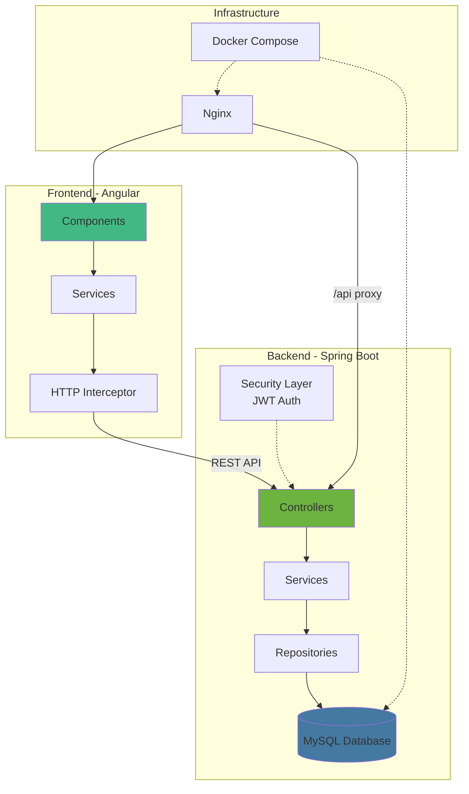

# Clinic Queue Management System | ระบบจัดการคิวและนัดหมายคลินิก

[English](#english) | [ภาษาไทย](#thai)

---

<a name="english"></a>
## 🇬🇧 English

### Overview
A full-stack web application for managing clinic appointments and walk-in queues. Built with Angular 17, Spring Boot 3, and MySQL 8, featuring JWT authentication, queue management, and patient tracking. This is a portfolio demonstration project showcasing clean code practices and full-stack development skills.

### Features
- **Staff Authentication**: Secure JWT-based login system
- **Patient Management**: CRUD operations with search and pagination
- **Appointment Scheduling**: 
  - Book, reschedule, and cancel appointments
  - Automatic double-booking prevention
  - Calendar and list views
- **Walk-in Queue System**:
  - Issue queue numbers automatically
  - Queue status tracking (waiting / called / in service / done / skipped)
  - "Call Next" functionality
  - Public display screen for patients (auto-refreshes every 5 seconds)
- **Dashboard**: 
  - Today's statistics (appointments, queue counts)
  - 7-day historical data table
  - Average waiting time calculation
- **Timezone Support**: Consistent Asia/Bangkok timezone handling throughout

### Technology Stack

**Frontend:**
- Angular 17 (Standalone Components)
- TypeScript
- RxJS
- Responsive CSS

**Backend:**
- Spring Boot 3.2
- Java 17
- Spring Data JPA
- Spring Security + JWT
- Bean Validation
- MySQL 8

**DevOps:**
- Docker & Docker Compose
- Flyway Migrations
- GitHub Actions CI
- Nginx

### Architecture



### Project Structure

```
clinic-queue-system/
├── backend/
│   ├── src/main/java/com/clinic/queue/
│   │   ├── controller/      # REST API endpoints
│   │   ├── service/         # Business logic
│   │   ├── repository/      # Data access layer
│   │   ├── entity/          # JPA entities
│   │   ├── dto/             # Data transfer objects
│   │   ├── security/        # JWT authentication
│   │   ├── exception/       # Global exception handling
│   │   └── config/          # Configuration classes
│   ├── src/main/resources/
│   │   └── db/migration/    # Flyway SQL migrations
│   └── src/test/            # Unit and integration tests
├── frontend/
│   └── src/app/
│       ├── components/      # Angular standalone components
│       ├── services/        # HTTP services
│       ├── models/          # TypeScript interfaces
│       ├── guards/          # Route guards
│       └── interceptors/    # HTTP interceptors
├── docker-compose.yml       # Multi-container setup
├── .github/workflows/       # CI/CD pipelines
└── docs/                    # Screenshots and documentation
```

### Quick Start

#### Prerequisites
- Docker & Docker Compose
- (Optional for local dev) Java 17, Node.js 18, MySQL 8

#### Running with Docker

1. Clone the repository:
```bash
git clone <repository-url>
cd clinic-queue-system
```

2. Create environment file:
```bash
cp .env.example .env
# Edit .env if needed (default values work out of the box)
```

3. Start all services:
```bash
docker-compose up --build
```

4. Access the application:
- **Frontend**: http://localhost
- **Backend API**: http://localhost:8080/api
- **Queue Display**: http://localhost/queue-display

#### Demo Account
- **Username**: `demo`
- **Password**: `demo123`

### API Overview

#### Authentication
- `POST /api/auth/login` - User login

#### Patients
- `GET /api/patients?search={term}&page={n}&size={n}` - List patients
- `GET /api/patients/{id}` - Get patient details
- `POST /api/patients` - Create patient
- `PUT /api/patients/{id}` - Update patient
- `DELETE /api/patients/{id}` - Soft delete patient

#### Appointments
- `GET /api/appointments?startDate={date}&endDate={date}` - List appointments
- `POST /api/appointments` - Create appointment (with conflict check)
- `PUT /api/appointments/{id}` - Update appointment
- `PATCH /api/appointments/{id}/status` - Update status
- `DELETE /api/appointments/{id}` - Cancel appointment

#### Queue
- `GET /api/queue/today` - Get today's queue
- `POST /api/queue` - Add to queue
- `POST /api/queue/call-next` - Call next waiting number
- `PATCH /api/queue/{id}/status` - Update queue status
- `GET /api/queue/display/today` - Public display (no auth)

#### Dashboard
- `GET /api/dashboard` - Get statistics and charts

### Development

#### Backend
```bash
cd backend
mvn clean install
mvn spring-boot:run
```

#### Frontend
```bash
cd frontend
npm install
npm start
```

#### Running Tests
```bash
# Backend tests
cd backend && mvn test

# Frontend tests
cd frontend && npm test
```

### Screenshots

#### Dashboard


#### Patient Management


#### Appointment Scheduling


#### Queue Management


#### Public Queue Display


### Key Implementation Highlights

#### 1. Double-Booking Prevention
The system uses a custom JPA query to check for time slot conflicts before saving appointments.

#### 2. Queue Number Generation
Automatic sequential queue numbers per day (Q001, Q002, etc.)

#### 3. Timezone Consistency
All datetime handling uses Asia/Bangkok timezone consistently across database, backend, and frontend.

#### 4. JWT Authentication
Stateless authentication with token-based security (24-hour expiration, HTTP interceptor for auth headers)

### What Could Be Improved

1. **Real-time Updates**: WebSocket for live queue updates instead of polling
2. **SMS Notifications**: Notify patients when their queue is called
3. **Multi-clinic Support**: Branch management for multi-location businesses
4. **Advanced Reporting**: Export to PDF/Excel, more detailed analytics
5. **Patient Self-Service**: Online booking and queue checking
6. **Mobile Apps**: iOS/Android apps with push notifications
7. **Role-based Access**: Different permissions for doctors, nurses, admin
8. **Appointment Reminders**: Automated email/SMS reminders
9. **Payment Tracking**: Receipt generation and payment history
10. **Medical Records**: Basic EMR features (diagnoses, prescriptions)

### License
This project is a portfolio demonstration and is provided as-is for educational purposes.

---

<a name="thai"></a>
## 🇹🇭 ภาษาไทย

### ภาพรวม
แอปพลิเคชันเว็บแบบ full-stack สำหรับจัดการนัดหมายและคิว Walk-in ของคลินิก พัฒนาด้วย Angular 17, Spring Boot 3 และ MySQL 8 มีระบบ JWT authentication, การจัดการคิวแบบเรียลไทม์ และระบบติดตามผู้ป่วยที่ครบถ้วน

### ฟีเจอร์หลัก
- **ระบบ Authentication**: เข้าสู่ระบบแบบปลอดภัยด้วย JWT
- **จัดการผู้ป่วย**: เพิ่ม แก้ไข ลบ ค้นหาผู้ป่วยพร้อมระบบ pagination
- **นัดหมาย**: 
  - จองนัด เปลี่ยนนัด ยกเลิกนัด
  - ป้องกันการนัดซ้อนเวลาเดียวกันอัตโนมัติ
  - แสดงผลแบบปฏิทินและรายการ
- **ระบบคิว Walk-in**:
  - ออกหมายเลขคิวอัตโนมัติ
  - ติดตามสถานะคิว (รอเรียก / เรียกแล้ว / กำลังให้บริการ / เสร็จสิ้น / ข้าม)
  - ฟังก์ชัน "เรียกคิวถัดไป"
  - หน้าจอแสดงคิวสาธารณะสำหรับผู้ป่วย
- **แดชบอร์ด**: 
  - สถิติแบบเรียลไทม์ (นัดหมายวันนี้, จำนวนคิว)
  - กราฟย้อนหลัง 7 วัน
  - คำนวณเวลารอเฉลี่ย
- **รองรับ Timezone**: จัดการเวลาแบบสอดคล้องกันทั้งระบบ (Asia/Bangkok)

### เทคโนโลยีที่ใช้

**Frontend:**
- Angular 17 (Standalone Components)
- TypeScript
- RxJS
- Responsive CSS

**Backend:**
- Spring Boot 3.2
- Java 17
- Spring Data JPA
- Spring Security + JWT
- Bean Validation
- MySQL 8

**DevOps:**
- Docker & Docker Compose
- Flyway Migrations
- GitHub Actions CI
- Nginx

### สถาปัตยกรรม


### โครงสร้างโปรเจกต์

```
clinic-queue-system/
├── backend/
│   ├── src/main/java/com/clinic/queue/
│   │   ├── controller/      # REST API endpoints
│   │   ├── service/         # Business logic
│   │   ├── repository/      # Data access layer
│   │   ├── entity/          # JPA entities
│   │   ├── dto/             # Data transfer objects
│   │   ├── security/        # JWT authentication
│   │   ├── exception/       # Global exception handling
│   │   └── config/          # Configuration classes
│   ├── src/main/resources/
│   │   └── db/migration/    # Flyway SQL migrations
│   └── src/test/            # Unit and integration tests
├── frontend/
│   └── src/app/
│       ├── components/      # Angular standalone components
│       ├── services/        # HTTP services
│       ├── models/          # TypeScript interfaces
│       ├── guards/          # Route guards
│       └── interceptors/    # HTTP interceptors
├── docker-compose.yml       # Multi-container setup
├── .github/workflows/       # CI/CD pipelines
└── docs/                    # Screenshots and documentation
```

### วิธีเริ่มใช้งาน

#### ความต้องการเบื้องต้น
- Docker & Docker Compose
- (ไม่จำเป็นสำหรับ Docker) Java 17, Node.js 18, MySQL 8

#### รันด้วย Docker

1. Clone repository:
```bash
git clone <repository-url>
cd clinic-queue-system
```

2. สร้างไฟล์ environment:
```bash
cp .env.example .env
# แก้ไข .env ตามต้องการ (ค่า default ใช้ได้เลย)
```

3. เริ่มต้นทุก service:
```bash
docker-compose up --build
```

4. เข้าใช้งานแอปพลิเคชัน:
- **Frontend**: http://localhost
- **Backend API**: http://localhost:8080/api
- **หน้าจอแสดงคิว**: http://localhost/queue-display

#### บัญชีทดสอบ
- **Username**: `demo`
- **Password**: `demo123`

### API หลัก

#### Authentication
- `POST /api/auth/login` - เข้าสู่ระบบ

#### ผู้ป่วย
- `GET /api/patients?search={term}&page={n}&size={n}` - ดูรายการผู้ป่วย
- `GET /api/patients/{id}` - ดูรายละเอียดผู้ป่วย
- `POST /api/patients` - เพิ่มผู้ป่วย
- `PUT /api/patients/{id}` - แก้ไขผู้ป่วย
- `DELETE /api/patients/{id}` - ลบผู้ป่วย (soft delete)

#### นัดหมาย
- `GET /api/appointments?startDate={date}&endDate={date}` - ดูรายการนัดหมาย
- `POST /api/appointments` - สร้างนัดหมาย (ตรวจสอบความซ้ำซ้อน)
- `PUT /api/appointments/{id}` - แก้ไขนัดหมาย
- `PATCH /api/appointments/{id}/status` - อัปเดตสถานะ
- `DELETE /api/appointments/{id}` - ยกเลิกนัดหมาย

#### คิว
- `GET /api/queue/today` - ดูคิววันนี้
- `POST /api/queue` - เพิ่มเข้าคิว
- `POST /api/queue/call-next` - เรียกคิวถัดไป
- `PATCH /api/queue/{id}/status` - อัปเดตสถานะคิว
- `GET /api/queue/display/today` - หน้าจอสาธารณะ (ไม่ต้อง login)

#### แดชบอร์ด
- `GET /api/dashboard` - ดูสถิติและกราฟ

### การพัฒนา

#### Backend
```bash
cd backend
mvn clean install
mvn spring-boot:run
```

#### Frontend
```bash
cd frontend
npm install
npm start
```

#### รัน Tests
```bash
# Backend tests
cd backend && mvn test

# Frontend tests
cd frontend && npm test
```

### ภาพหน้าจอ

#### แดชบอร์ด


#### จัดการผู้ป่วย


#### นัดหมาย


#### จัดการคิว


#### หน้าจอแสดงคิว


### จุดเด่นในการพัฒนา

#### 1. ป้องกันการนัดซ้ำเวลา
ใช้ custom JPA query ตรวจสอบความซ้ำซ้อนของช่วงเวลา

#### 2. สร้างหมายเลขคิวอัตโนมัติ
เพิ่มหมายเลขคิวตามลำดับในแต่ละวัน (Q001, Q002, ...)

#### 3. จัดการ Timezone อย่างสม่ำเสมอ
ทุกส่วนของระบบใช้ Asia/Bangkok timezone

#### 4. JWT Authentication
Authentication แบบ stateless ด้วย token

### สิ่งที่สามารถพัฒนาต่อได้

1. **อัปเดตแบบเรียลไทม์**: ใช้ WebSocket แทนการ polling
2. **แจ้งเตือน SMS**: แจ้งผู้ป่วยเมื่อถึงคิว
3. **รองรับหลายสาขา**: จัดการหลายคลินิก/สาขา
4. **รายงานขั้นสูง**: ส่งออก PDF/Excel, วิเคราะห์เชิงลึก
5. **Self-Service สำหรับผู้ป่วย**: จองนัดและเช็คคิวออนไลน์
6. **แอปมือถือ**: iOS/Android พร้อม push notification
7. **จัดการสิทธิ์**: แยกสิทธิ์แพทย์ พยาบาล แอดมิน
8. **เตือนนัดหมาย**: ส่ง email/SMS อัตโนมัติ
9. **บันทึกการชำระเงิน**: ออกใบเสร็จและประวัติการชำระ
10. **ประวัติการรักษา**: ฟีเจอร์ EMR พื้นฐาน

### License
โปรเจกต์นี้สร้างขึ้นเพื่อเป็น portfolio และให้ใช้เพื่อการศึกษาเท่านั้น
